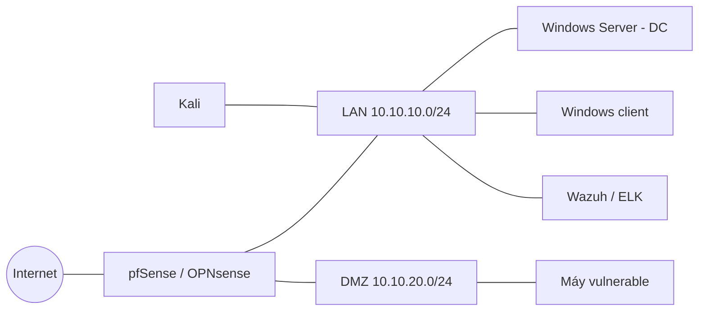

# Sơ đồ mạng home lab

> Vẽ bằng Mermaid (xem trực tiếp trong VS Code/Obsidian) hoặc draw.io rồi lưu ảnh vào `anh/`.

| Mạng | Dải IP | Mục đích | Cách ly |
| --- | --- | --- | --- |
| LAN | 10.10.10.0/24 | Máy nội bộ giả lập | Internal |
| DMZ | 10.10.20.0/24 | Dịch vụ lộ ra ngoài | Internal |
| Attack | 10.10.30.0/24 | Kali / tool tấn công | Host-only |

> Sơ đồ trên chỉ là gợi ý — sửa lại theo lab thật của bạn.
