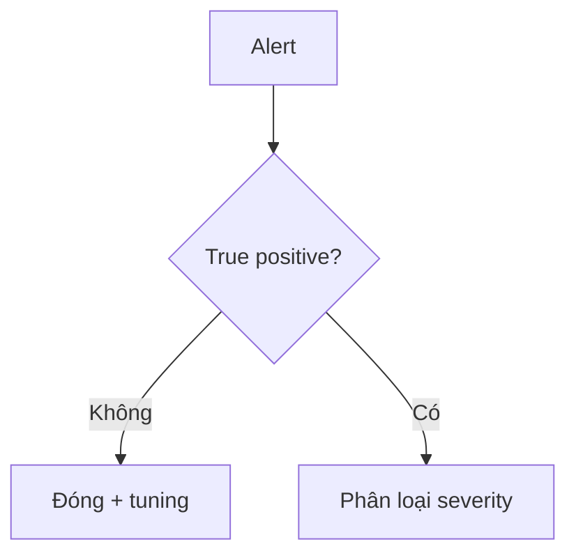

# Playbook IR: <loại sự cố>  (ví dụ: Phishing / Ransomware / Tài khoản bị chiếm / Lộ dữ liệu / Web shell)

- **Phiên bản:** 0.1 · **Chủ sở hữu:** … · **Xem lại lần cuối:** ____
- **Điều kiện kích hoạt:** …
- **Mức độ nghiêm trọng (severity matrix):** …

## 1. Preparation (đã chuẩn bị gì)
…

## 2. Detection & Analysis
| Bước | Hành động | Công cụ/Query | Kết quả mong đợi |
| --- | --- | --- | --- |

## 3. Containment
- Ngắn hạn: …
- Dài hạn: …

## 4. Eradication
…

## 5. Recovery
…

## 6. Liên lạc & escalation
| Đối tượng | Khi nào | Kênh (out-of-band) | Mẫu thông báo |
| --- | --- | --- | --- |

## 7. Nghĩa vụ pháp lý / thông báo
…

## 8. Post-incident
- Postmortem trong ≤ ____ ngày. Metrics: MTTD, MTTR.

## 9. Sơ đồ quyết định

