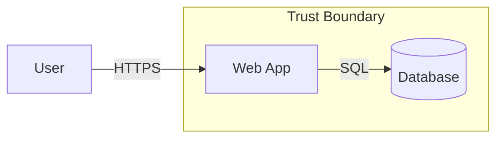

# Threat Model (STRIDE) — <Tên hệ thống>

## 1. Phạm vi & giả định
…

## 2. Data Flow Diagram

> Thay bằng DFD thật; đánh dấu **trust boundary**, data store, process, external entity.

## 3. Bảng mối đe dọa
| ID | Phần tử DFD | STRIDE | Mối đe dọa | Điều kiện/đường tấn công | Mức độ | Biện pháp giảm thiểu | Trạng thái |
| --- | --- | --- | --- | --- | --- | --- | --- |
| T01 |  | S |  |  |  |  | ⬜ |

## 4. Mapping tới risk register
| Threat | Risk ID |
| --- | --- |

## 5. Việc cần làm
- [ ] …
